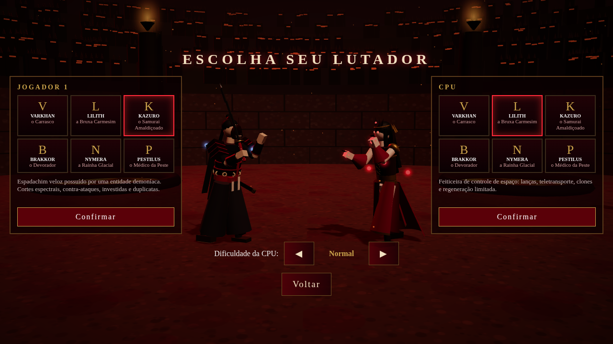
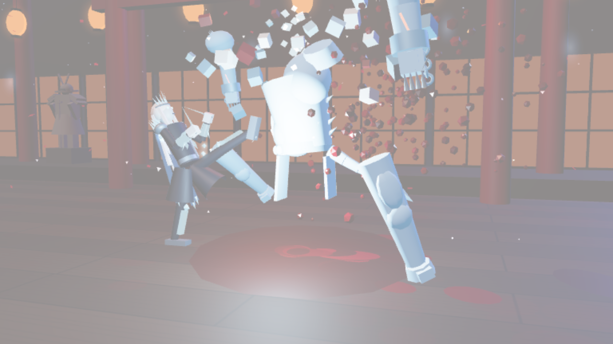
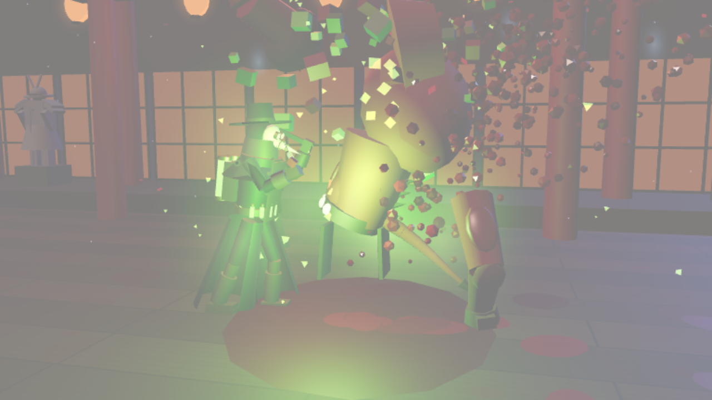
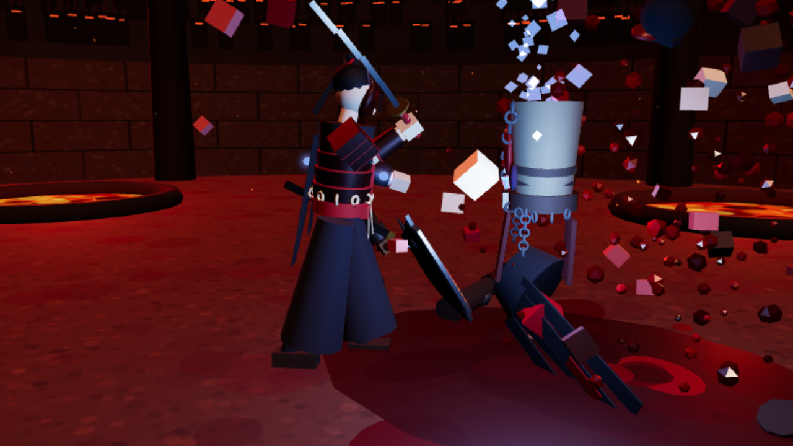
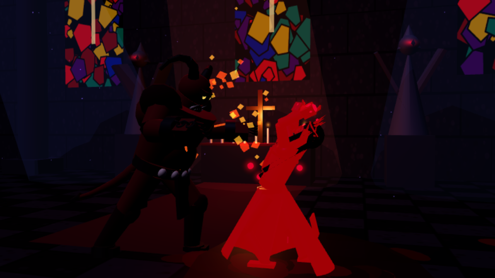

# SANGUINARIUM — Pacto de Sangue (v0.4.0)

Jogo de luta 2.5D de fantasia sombria (18+) feito com **Three.js** (incluído em `vendor/`, funciona offline).
Conteúdo: **Varkhan, o Carrasco**, **Lilith, a Bruxa Carmesim**, **Kazuro, o Samurai Amaldiçoado**, **Brakkor, o Devorador**,
**Nymera, a Rainha Glacial** e **Pestilus, o Médico da Peste**; arenas **Coliseu Carmesim**, **Catedral Profana**,
**Templo dos Samurais Mortos** e **Forja Infernal**, cada uma com elementos interativos e uma transição para um segundo
cenário (**Fosso do Coliseu** / **Cripta Profana** / **Cemitério dos Ronins** / **Coração da Forja**);
Modo Arcade (escada de 6 lutas com final por personagem), 1 jogador vs CPU (5 dificuldades), 2 jogadores locais,
treinamento, controles de toque e gamepad, remapeamento de teclado (J1 e J2) e de gamepad, sangue com poças
persistentes, ferimentos progressivos, **24 Sentenças de Sangue** (4 por personagem) e **2 supergolpes por personagem**.

**Jogue no navegador:** https://luispauloalves500.github.io/sanguinarium/

> Os lutadores continuam sendo **placeholders** montados com primitivas 3D (ver `CHECKPOINTS.md`).

## Novidades da v0.4.0
- **Nymera, a Rainha Glacial** — assassina de controle: lança de gelo (EX congela), espinhos no alvo, **armadilha de
  gelo** no chão (imbloqueável, congela), clone congelado (contra-ataque), deslize baixo, garra antiaérea, nevasca e
  passo glacial (teletransporte). Congelamentos prendem o oponente num **bloco de gelo**.
- **Pestilus, o Médico da Peste** — alquimista de área: **bomba tóxica em arco que vira nuvem**, **nuvem corrosiva**
  persistente, **veneno** (dano por tempo, para em 1 PV) na seringa, bisturi e frascos, enxame de ratos (baixo), corvos
  por cima, explosão miasmática.
- Cada um com 8 especiais + EX, 2 supergolpes, transformação, 4 Sentenças com câmera cinematográfica, IA, final de
  Arcade, lista de golpes e seleção.
- **Arenas do GDD:** Templo dos Samurais Mortos (Espírito Ancestral, Estátua do Guardião destrutível, transição para o
  Cemitério dos Ronins) e Forja Infernal (Corrente da Forja, Boca da Fornalha, transição para o Coração da Forja).
- **Remapeamento do Jogador 2 e do gamepad** (Opções → Controles: Teclado J1/J2, Gamepad J1/J2).
- **Correções:** dica do HUD do J2 com a tecla real; cabeça do Brakkor no quadro em cinemáticas; estátua da Catedral
  não atravessa mais quem a derrubou.
- **Balanceamento** com 6 lutadores: todos entre 45% e 55% (CPU×CPU, dif. 2–4). Arcade com 6 lutas.

## Novidades da v0.3.0
- **Kazuro, o Samurai Amaldiçoado** — espadachim veloz: cortes espectrais (projétil), investida com invencibilidade,
  iaijutsu, contra-ataque (Lâmina Reflexa), dança de 5 cortes, duplicata sombria, antiaéreo e teletransporte.
- **Brakkor, o Devorador** — demônio gigante: agarrões de comando (Esmagamento; Devorar cura), investida e punho com
  **superarmadura**, bola de fogo, sopro infernal, salto esmagador (por cima) e **terremoto** (baixo; pule).
- Cada um com 8 especiais (+ potencializados), 2 supergolpes, transformação, 4 Sentenças de Sangue com câmera
  cinematográfica, IA própria, final de Arcade e entrada na lista de golpes/seleção.
- **Correções da v0.2:** a Estátua do Carrasco colide e tira o oponente de baixo dela; cambalhota e quedas mais suaves;
  lista de golpes, controles e dicas mostram as **teclas remapeadas**.
- Arcade com 4 lutas (3 rivais + Reflexo Sombrio). Balanceamento CPU×CPU entre os 4 (ver `CHECKPOINTS.md`).

## Novidades da v0.2.0
- **Correções:** pernas ao ajoelhar/agachar/estocada (IK de duas articulações com pés plantados e planos), lanças do
  Ritual Proibido finas com ponta farpada, cabeça decepada legível (coto, brilho, rastro de sangue e câmera que a segue).
- **Desempenho:** qualidade **Automática** (padrão) com resolução dinâmica (baixa quando cai de ~52 qps; desliga sombras
  só em último caso), preset baixo automático no celular, luz de clarão reutilizada (sem recompilar shaders no meio
  da luta), pré-compilação de shaders, opção “Mostrar qps”.
- **Visual:** Varkhan com placa peitoral com caveira, correntes penduradas, ombreiras com espetos, capa rasgada com
  física de mola e machado maior em crescente (chamas na Fúria); Lilith com corpete dourado, saia em painéis que seguem
  as pernas, mangas de sino, garras, cabelo com mola e orbes de sangue orbitando. Animações com molas secundárias.
- **Conteúdo:** Sentenças 3 e 4 por personagem; 2º supergolpe por personagem (Tribunal dos Condenados; Sabá Sangrento);
  arenas interativas e transições; Modo Arcade; remapeamento de teclas do Jogador 1.

## Como rodar

O jogo é uma pasta estática. Abra um servidor na pasta (módulos ES não funcionam via `file://`):

```bash
python3 -m http.server 8080      # depois abra http://localhost:8080
# ou
npx serve .
```

No celular, use o link do GitHub Pages acima ou o endereço da rede local (`http://IP-do-PC:8080`), em paisagem.

## Controles (padrão; J1, J2 e gamepads podem ser remapeados em Opções)

| Ação | Jogador 1 | Jogador 2 | Toque |
|---|---|---|---|
| Movimento | W A S D (setas no modo 1P) | Setas | Direcional virtual |
| Soco rápido / forte | J / K | Num1 / Num2 (Insert / Home) | SR / SF |
| Chute rápido / forte | U / I | Num4 / Num5 (Delete / End) | CR / CF |
| Bloqueio (segurar; agachado bloqueia baixos) | L | Num3 (PageDown) | DEF |
| Agarrão (e escapar de agarrão) | O | Num6 (PageUp) | AGR |
| Esquiva | Espaço | Num0 (Shift direito) | ESQ |
| Especial simplificado (+ direção) | P | Num+ (Enter) | ESP |
| Especial potencializado (1 barra) | comando + J+K | | |
| Supergolpe 1 (2 barras) | U + I | | ESP + ↑ |
| **Supergolpe 2 (2 barras)** | **↓ + U + I** | | **ESP + ↗** |
| **Elemento da arena** | **↑ + O** perto da borda, de costas para ela | | ↑ + AGR |
| Transformação (Fúria cheia) | L + O | | |
| Quebra de combo (2 barras) | Espaço + L durante o combo sofrido | | |
| Pausa | Esc | | botão II |

Comandos de especiais (relativos ao lado do lutador): `↓→`, `↓←`, `←→`, `↓↓` + Soco/Chute. A lista completa
(dano, início, vantagem no bloqueio, supergolpes, combos, fatalidades e arenas) está no menu **Lista de Golpes**.

### Supergolpes
| Personagem | Supergolpe 1 (U + I) | Supergolpe 2 (↓ + U + I) |
|---|---|---|
| Varkhan | Execução Carmesim | **Tribunal dos Condenados** (médio, alcance longo; carrascos espectrais) |
| Lilith | Eclipse Sangrento | **Sabá Sangrento** (golpe **baixo**: defenda agachado; pentagrama e lanças) |
| Kazuro | Tempestade de Lâminas | Despertar do Oni (a entidade gigante corta três vezes) |
| Brakkor | Apocalipse Ígneo (meteoros e pilar de fogo) | **Banquete do Devorador** (agarrão imbloqueável de curto alcance; cura 80) |
| Nymera | **Inverno Eterno** (nevasca e lanças; prende no gelo) | **Túmulo de Gelo** (sarcófago de estacas que implode) |
| Pestilus | **Pandemia** (nuvem pestilenta) | **Praga Negra** (revoada de corvos) |

### Especiais dos novos lutadores
| Comando | Kazuro | Brakkor |
|---|---|---|
| `↓→` + Soco (ESP) | Corte Espectral (projétil) | Bola de Fogo Infernal |
| `↓→` + Chute (ESP + →) | Investida Relâmpago | Investida do Touro (superarmadura) |
| `↓←` + Soco | Iaijutsu do Vazio | Esmagamento (agarrão de comando, ESP + ←) |
| `↓←` + Chute | Lâmina Reflexa (contra-ataque, ESP + ←) | Sopro Infernal (4 golpes) |
| `←→` + Soco | Dança das Mil Lâminas (5 cortes) | Punho de Magma (superarmadura) |
| `←→` + Chute | Duplicata Sombria | Salto Esmagador (por cima) |
| `↓↓` + Soco (ESP + ↓) | Lâmina Ascendente (antiaéreo) | Terremoto (baixo) |
| `↓↓` + Chute | Passo das Sombras (teletransporte) | Devorar (agarrão que cura 60) |

| Comando | Nymera | Pestilus |
|---|---|---|
| `↓→` + Soco (ESP) | Lança de Gelo (EX congela) | Bomba Tóxica (arco → nuvem) |
| `↓→` + Chute (ESP + →) | Deslize Glacial (baixo) | Bisturi Corrompido (envenena) |
| `↓←` + Soco | Espinhos Glaciais (no alvo) | Nuvem Corrosiva (persistente) |
| `↓←` + Chute (ESP + ↓) | Armadilha de Gelo (imbloqueável) | Enxame de Ratos (baixo, ESP + ↓) |
| `←→` + Soco (ESP + ←) | Clone Congelado (contra-ataque) | Seringa Venenosa |
| `←→` + Chute | Garra do Inverno (antiaéreo) | Corvos da Peste (por cima) |
| `↓↓` + Soco | Nevasca (4 golpes) | Explosão Miasmática (antiaéreo, ESP + ←) |
| `↓↓` + Chute | Passo Glacial (teletransporte) | Frasco Ácido (2 golpes) |

### Sentenças de Sangue (após “FINALIZE-O!” no último round)
| Personagem | Sentença | Comando | Distância | Toque |
|---|---|---|---|---|
| Varkhan | Execução Real | `↓ → ↓ + K` | perto | ESP |
| Varkhan | Machado da Condenação | `← → ← + I` | longe | ESP + ↓ |
| Varkhan | **Correntes do Suplício** | `→ ← → + J` | média | ESP + → |
| Varkhan | **Ruptura Infernal** | `↓ ↓ ↓ + U` | perto | ESP + ← |
| Lilith | Explosão Carmesim | `↓ → → + K` | média | ESP |
| Lilith | Ritual Proibido | `← ← ↓ + I` | perto | ESP + ↓ |
| Lilith | **Beijo da Morte** | `→ → ↓ + J` | perto | ESP + → |
| Lilith | **Chuva de Lanças Final** | `← ↓ ← + U` | longe | ESP + ← |
| Kazuro | Mil Cortes | `→ ← → + K` | perto | ESP |
| Kazuro | Último Suspiro | `← ← → + I` | média | ESP + ↓ |
| Kazuro | Corte Fantasma | `↓ ← ↓ + J` | perto | ESP + → |
| Kazuro | Possessão Oni | `→ ↓ → + U` | longe | ESP + ← |
| Brakkor | Devorador de Almas | `↓ ↓ → + K` | colado/perto | ESP |
| Brakkor | Fornalha Infernal | `← → ↓ + I` | perto/média | ESP + ↓ |
| Brakkor | Esmagamento Sísmico | `↓ → → + U` | média | ESP + → |
| Brakkor | Rasgo Duplo | `→ → ← + J` | colado | ESP + ← |
| Nymera | Estilhaços Humanos | `↓ → ↓ + K` | perto | ESP |
| Nymera | Frio Absoluto | `← → → + I` | longe | ESP + ↓ |
| Nymera | **Coração de Gelo** | `→ → ← + J` | colado | ESP + → |
| Nymera | **Prisão Cristalina** | `↓ ↓ → + U` | média | ESP + ← |
| Pestilus | Decomposição | `↓ ← ↓ + K` | perto/média | ESP |
| Pestilus | Último Experimento | `→ ← → + I` | colado | ESP + ↓ |
| Pestilus | **Enxame Faminto** | `← ← → + J` | longe | ESP + → |
| Pestilus | **Dissecação** | `↓ ↓ ← + U` | perto | ESP + ← |

### Arenas interativas (desligáveis em Opções → “Perigos e transições de arena”)
- **Corrente do Muro** (Coliseu/Fosso): `↑ + O` de costas para a borda — salta por cima do oponente.
- **Estátua do Carrasco** (Catedral/Cripta): `↑ + O` de costas para a borda — a estátua tomba sobre o oponente
  (90 de dano, golpe alto: bloqueie em pé; uma por lado por round).
- **Poço de Lava / Braseiro Profano**: derrubar o oponente perto da borda causa +50 de dano.
- **Espírito Ancestral** (Templo/Cemitério): `↑ + O` de costas para o altar — um samurai fantasma atravessa a arena
  (uma vez por lado por round).
- **Estátua do Guardião** (Templo): derrubar o oponente na borda quebra a estátua sobre ele (dano extra, uma por lado).
- **Corrente da Forja** (Forja/Coração): `↑ + O` de costas para a borda — balança e chuta o oponente (bloqueável).
- **Boca da Fornalha**: lava na borda da Forja (+50 em derrubada).
- **Transição**: golpe pesado que derruba (ex.: rasteira `↓ + I`) colado à borda arremessa o oponente para o
  **Fosso do Coliseu**, a **Cripta Profana**, o **Cemitério dos Ronins** ou o **Coração da Forja** (+70 de dano, uma
  vez por luta). A luta continua no novo cenário.

### Modo Arcade
Escolha o lutador e enfrente 6 lutas (os outros 5 lutadores nas 4 arenas → Reflexo Sombrio, com dificuldade crescente). Derrota
permite continuar a mesma luta; vencer a última mostra o final do personagem.

## Desenvolvimento

```bash
npm test                 # testes automatizados da simulação (node --test)
node tools/balance.mjs   # balanceamento CPU×CPU entre os 6 lutadores
node tools/qa.mjs        # QA no Chromium headless (precisa de servidor em http://127.0.0.1:8090)
node tools/live.mjs      # verifica o site publicado (GitHub Pages) sem erros de console
python3 tools/build.py   # gera /workspace/sanguinarium-build.zip
```

Ferramentas de inspeção visual: `tools/poseshot.mjs` (poses), `tools/cineshot.mjs` (cinemáticas),
`tools/arenashot.mjs` (elementos de arena).

Estrutura: `src/combat` (dados de golpes, entrada, simulação determinística 60 Hz, regras de arena em `arena.js`),
`src/hitboxes`, `src/ai`, `src/animation` (poses e máquina de estados), `src/characters` (modelos), `src/render`
(cena/arenas/VFX/desempenho), `src/blood`, `src/fatalities` (timelines), `src/camera`, `src/audio` (Web Audio
procedural), `src/input`, `src/ui`, `src/modes` (Arcade).

## Capturas

Veja `docs/screenshots/` e `docs/qa-report.json`.








