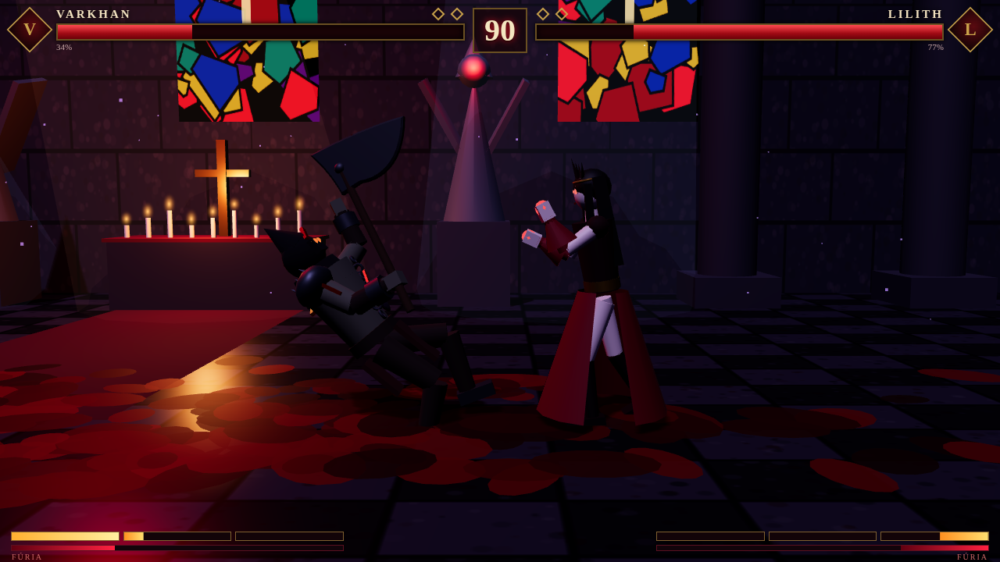

# SANGUINARIUM — Pacto de Sangue (primeira versão jogável v0.1.0)

Jogo de luta 2.5D de fantasia sombria (18+) feito com **Three.js** (incluído em `vendor/`, funciona offline).
Conteúdo desta versão (GDD §23): **Varkhan, o Carrasco** e **Lilith, a Bruxa Carmesim**; arenas **Coliseu Carmesim** e
**Catedral Profana**; 1 jogador vs CPU (5 dificuldades), 2 jogadores locais, treinamento, controles de toque e gamepad,
sangue com poças persistentes, ferimentos progressivos e quatro Sentenças de Sangue (fatalidades) cinematográficas.

> Os lutadores são **placeholders** montados com primitivas 3D (ver `CHECKPOINTS.md`).

## Como rodar

O jogo é uma pasta estática. Abra um servidor na pasta (módulos ES não funcionam via `file://`):

```bash
python3 -m http.server 8080      # depois abra http://localhost:8080
# ou
npx serve .
```

No celular, acesse o mesmo endereço pela rede local (ex.: `http://IP-do-PC:8080`). Use o celular deitado (paisagem).

## Controles

| Ação | Jogador 1 | Jogador 2 | Toque |
|---|---|---|---|
| Movimento | W A S D (setas no modo 1P) | Setas | Direcional virtual |
| Soco rápido / forte | J / K | Num1 / Num2 (Insert / Home) | SR / SF |
| Chute rápido / forte | U / I | Num4 / Num5 (Delete / End) | CR / CF |
| Bloqueio (segurar; agachado bloqueia baixos) | L | Num3 (PageDown) | DEF |
| Agarrão (e escapar de agarrão) | O | Num6 (PageUp) | AGR |
| Esquiva | Espaço | Num0 (Shift direito) | ESQ |
| Especial simplificado (+ direção) | P | Num+ (Enter) | ESP |
| Especial potencializado (1 barra) | comando + J+K | | |
| Supergolpe (2 barras) | U + I | | ESP + ↑ |
| Transformação (Fúria cheia) | L + O | | |
| Quebra de combo (2 barras) | Espaço + L durante o combo sofrido | | |
| Pausa | Esc | | botão II |

Comandos de especiais (relativos ao lado do lutador): `↓→`, `↓←`, `←→`, `↓↓` + Soco/Chute. A lista completa
(dano, início, vantagem no bloqueio, combos e fatalidades) está no menu **Lista de Golpes**.

**Sentenças de Sangue** (após “FINALIZE-O!” no último round):
- Varkhan: *Execução Real* `↓ → ↓ + K` (perto) · *Machado da Condenação* `← → ← + I` (longe)
- Lilith: *Explosão Carmesim* `↓ → → + K` (média) · *Ritual Proibido* `← ← ↓ + I` (perto)
- No toque: `ESP` (1ª) ou `ESP + ↓` (2ª), respeitando a distância.

## Desenvolvimento

```bash
npm test                 # testes automatizados da simulação (node --test)
node tools/qa.mjs        # QA no Chromium headless (precisa de servidor em http://127.0.0.1:8090)
```

Estrutura: `src/combat` (dados de golpes, entrada, simulação determinística 60 Hz), `src/hitboxes`, `src/ai`,
`src/animation` (poses e máquina de estados), `src/characters` (modelos), `src/render` (cena/arenas/VFX), `src/blood`,
`src/fatalities` (timelines), `src/camera`, `src/audio` (Web Audio procedural), `src/input`, `src/ui`.

## Capturas

Veja `docs/screenshots/` (menu, seleção, lutas nas duas arenas, supergolpe, as 4 fatalidades, celular) e `docs/qa-report.json` (QA headless: 22/22 verificações, 0 erros de console).


